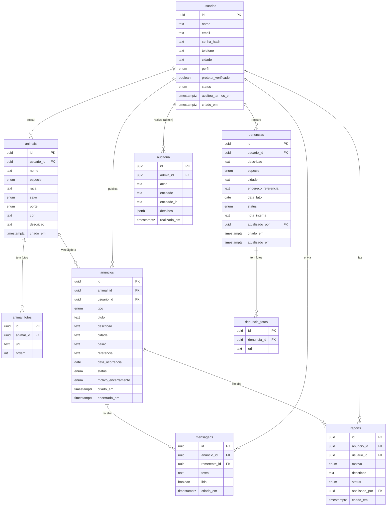

# spec.md — HousePet: Especificação Técnica Completa

> **Autora do projeto:** Laila Victória  
> **Curso:** 3º Ano de Informática — IFRO, Campus Porto Velho Calama  
> **Documento de origem:** `spec.pdf` — HousePet Spec inicial v0.1 (09/10/2026)  
> **Este arquivo:** Especificação técnica elaborada para orientar todas as etapas de desenvolvimento  
> **Elaborado em:** 23/10/2026

---

> ⚠️ **Nota sobre os documentos de entrada**
>
> Foram solicitados dois arquivos: `spec.Laila.pdf` e `Laila.'Formulario_Simulado_Centelha_HousePet_Preenchido'.docx`.  
> Na pasta do projeto, foi encontrado **apenas** o arquivo `spec.pdf` (242 KB, 9 páginas).  
> O arquivo `.docx` (formulário simulado do Centelha) **não estava presente** na pasta e não pôde ser lido.  
> Todo o conteúdo desta especificação é baseado exclusivamente no `spec.pdf`.  
> Caso o formulário `.docx` contenha requisitos adicionais, esta especificação deverá ser revisada após a inclusão desse arquivo.

---

## 1. Nome do sistema

**HousePet — Plataforma de Proteção, Adoção e Localização de Animais**

---

## 2. Objetivo

### Problema a resolver

Atualmente, informações sobre animais desaparecidos, disponíveis para adoção ou vítimas de maus-tratos circulam de forma dispersa em redes sociais, grupos de aplicativos de mensagem e murais informais. Esse espalhamento dificulta a busca, a organização, a moderação e o acompanhamento dos casos.

### O que o HousePet propõe

O HousePet é uma plataforma web que reúne, em um único ambiente centralizado:

1. **Registro e acompanhamento de denúncias de maus-tratos** — com fluxo de status e privacidade garantida ao denunciante.
2. **Divulgação de animais disponíveis para adoção** — com informações pesquisáveis e moderadas.
3. **Divulgação e localização de animais desaparecidos** — com campos de localização em texto (cidade, bairro e ponto de referência).

### Público-alvo

- Tutores de animais que perderam seus pets.
- Pessoas que encontraram animais perdidos ou em risco.
- Protetores independentes e organizações de proteção animal.
- Pessoas interessadas em adotar animais.
- Moderadores responsáveis pela integridade do conteúdo publicado.

### Benefícios esperados

- Substituir a divulgação dispersa por informações organizadas, pesquisáveis e moderadas.
- Facilitar o reencontro de animais desaparecidos com seus tutores.
- Aumentar as chances de adoção responsável.
- Oferecer um canal seguro para relatar suspeitas de maus-tratos, sem exposição pública do denunciante.

---

## 3. Usuários e permissões

O sistema possui quatro perfis de usuário, com permissões progressivas.

### 3.1 Visitante (não autenticado)

Qualquer pessoa que acessa o site sem ter feito login.

| Ação | Permitido? |
|---|---|
| Consultar lista de anúncios ativos (desaparecidos e adoção) | ✅ Sim |
| Ver página de detalhe de um anúncio | ✅ Sim |
| Usar busca e filtros de anúncios | ✅ Sim |
| Criar uma conta | ✅ Sim |
| Fazer login | ✅ Sim |
| Publicar anúncios | ❌ Não |
| Enviar mensagens a anunciantes | ❌ Não |
| Registrar denúncias de maus-tratos | ❌ Não |
| Reportar conteúdo inadequado | ❌ Não |
| Acessar painel de moderação | ❌ Não |

### 3.2 Usuário comum

Pessoa com conta e perfil definido como "comum" (tutor, adotante ou pessoa que encontrou um animal).

| Ação | Permitido? |
|---|---|
| Tudo que o visitante pode | ✅ Sim |
| Editar o próprio perfil (nome, telefone, cidade) | ✅ Sim |
| Alterar a própria senha | ✅ Sim |
| Cadastrar, editar e excluir seus animais | ✅ Sim |
| Publicar anúncio de animal desaparecido | ✅ Sim |
| Publicar anúncio de animal para adoção | ✅ Sim |
| Encerrar seus próprios anúncios | ✅ Sim |
| Enviar mensagens a anunciantes de anúncios ativos | ✅ Sim |
| Ler mensagens recebidas em seus anúncios | ✅ Sim |
| Registrar denúncias de maus-tratos | ✅ Sim |
| Acompanhar o status de suas denúncias | ✅ Sim |
| Reportar anúncio inadequado | ✅ Sim |
| Editar ou excluir animais/anúncios de outros usuários | ❌ Não |
| Acessar painel de moderação | ❌ Não |
| Ver denúncias de outros usuários | ❌ Não |

### 3.3 Protetor / Organização

Protetor independente, voluntário ou entidade com conta e perfil "protetor".

| Ação | Permitido? |
|---|---|
| Tudo que o usuário comum pode | ✅ Sim |
| Exibir o selo "Protetor verificado" (após aprovação do administrador) | ✅ Sim (condicional) |

> **Diferença em relação ao usuário comum:** O perfil protetor é elegível para receber o selo de verificação concedido por um administrador. Este selo aparece no perfil e nos anúncios da conta.

### 3.4 Administrador (moderador)

Membro da equipe do HousePet com acesso ao painel de moderação.

| Ação | Permitido? |
|---|---|
| Tudo que o usuário comum pode | ✅ Sim |
| Acessar o painel de moderação | ✅ Sim |
| Listar e analisar denúncias de maus-tratos | ✅ Sim |
| Alterar status de uma denúncia | ✅ Sim |
| Registrar nota interna em uma denúncia (invisível ao denunciante) | ✅ Sim |
| Listar e analisar reports de conteúdo | ✅ Sim |
| Marcar report como procedente ou improcedente | ✅ Sim |
| Ocultar ou restaurar anúncios | ✅ Sim |
| Suspender ou reativar usuários | ✅ Sim |
| Conceder ou remover o selo "Protetor verificado" | ✅ Sim |

---

## 4. Casos de uso principais

| Código | Caso de uso | Ator principal | RFs relacionados |
|---|---|---|---|
| UC01 | Criar conta | Visitante | RF01 |
| UC02 | Entrar e sair do sistema | Visitante, Usuário comum, Protetor, Administrador | RF02, RF17 |
| UC03 | Gerenciar perfil e senha | Usuário comum, Protetor | RF03 |
| UC04 | Gerenciar meus animais | Usuário comum, Protetor | RF04, RF17 |
| UC05 | Publicar animal desaparecido | Usuário comum, Protetor | RF05 |
| UC06 | Publicar animal para adoção | Usuário comum, Protetor | RF06 |
| UC07 | Encerrar anúncio (encontrado / adotado) | Usuário comum, Protetor | RF07 |
| UC08 | Consultar e buscar anúncios | Visitante e todos os logados | RF08, RF09 |
| UC09 | Contatar anunciante e ler mensagens recebidas | Usuário comum, Protetor | RF10 |
| UC10 | Registrar denúncia de maus-tratos | Usuário comum, Protetor | RF11 |
| UC11 | Acompanhar minhas denúncias | Usuário comum, Protetor | RF12 |
| UC12 | Reportar anúncio inadequado | Usuário comum, Protetor | RF13 |
| UC13 | Analisar denúncias e reports no painel de moderação | Administrador | RF14, RF17 |
| UC14 | Ocultar anúncio e suspender usuário | Administrador | RF15, RF17 |
| UC15 | Verificar protetor | Administrador | RF16, RF17 |

### Detalhamento dos casos de uso

#### UC01 — Criar conta
- **Pré-condição:** O visitante não possui conta cadastrada com o e-mail informado.
- **Resultado esperado:** Conta criada, senha gravada como hash bcrypt, usuário redirecionado ao login.

#### UC02 — Entrar e sair do sistema
- **Pré-condição (login):** Usuário possui conta ativa.
- **Resultado esperado (login):** Sessão iniciada via cookie HttpOnly; usuário redirecionado ao painel.
- **Resultado esperado (logout):** Sessão encerrada; tentativa de acesso a área restrita redireciona ao login.

#### UC03 — Gerenciar perfil e senha
- **Pré-condição:** Usuário logado.
- **Resultado esperado:** Dados de perfil atualizados; troca de senha exige confirmação da senha atual.

#### UC04 — Gerenciar meus animais
- **Pré-condição:** Usuário logado.
- **Resultado esperado:** Animal cadastrado, editado ou excluído; somente o dono pode modificar seus animais.

#### UC05 — Publicar animal desaparecido
- **Pré-condição:** Usuário logado com pelo menos um animal cadastrado.
- **Resultado esperado:** Anúncio criado com status "ativo", vinculado ao animal e visível nas listas públicas.

#### UC06 — Publicar animal para adoção
- **Pré-condição:** Usuário logado com pelo menos um animal cadastrado.
- **Resultado esperado:** Anúncio de adoção criado com status "ativo" e visível nas listas públicas.

#### UC07 — Encerrar anúncio
- **Pré-condição:** Usuário logado, dono do anúncio ativo.
- **Resultado esperado:** Anúncio marcado como "encerrado" (encontrado ou adotado), removido das listas públicas ativas, mantido no histórico do dono.

#### UC08 — Consultar e buscar anúncios
- **Pré-condição:** Nenhuma (aberto a visitantes).
- **Resultado esperado:** Listas paginadas de anúncios ativos; busca por texto e filtros combinados funcionando.

#### UC09 — Contatar anunciante e ler mensagens
- **Pré-condição:** Usuário logado; anúncio ativo de outro usuário.
- **Resultado esperado:** Mensagem gravada; dono do anúncio vê mensagem como não lida na própria conta.

#### UC10 — Registrar denúncia de maus-tratos
- **Pré-condição:** Usuário logado.
- **Resultado esperado:** Denúncia gravada com status "recebida"; nunca exibida publicamente.

#### UC11 — Acompanhar minhas denúncias
- **Pré-condição:** Usuário logado com denúncias registradas.
- **Resultado esperado:** Lista de denúncias próprias com status atual de cada uma.

#### UC12 — Reportar anúncio inadequado
- **Pré-condição:** Usuário logado; anúncio ativo de outro usuário.
- **Resultado esperado:** Report gravado com status "pendente" e visível no painel do administrador.

#### UC13 — Analisar denúncias e reports (painel de moderação)
- **Pré-condição:** Usuário com perfil administrador logado.
- **Resultado esperado:** Painel exibe denúncias e reports; administrador pode alterar status e registrar notas; ações são registradas com nome e data.

#### UC14 — Ocultar anúncio e suspender usuário
- **Pré-condição:** Usuário com perfil administrador logado.
- **Resultado esperado:** Anúncio oculto some das listas públicas; usuário suspenso não consegue fazer login e seus anúncios saem das listas.

#### UC15 — Verificar protetor
- **Pré-condição:** Usuário com perfil administrador logado; conta-alvo com perfil "protetor".
- **Resultado esperado:** Selo "Protetor verificado" concedido ou removido; aparece no perfil e nos anúncios da conta.

---

## 5. Requisitos funcionais (RF)

### Módulo 1 — Cadastro, login e logout

| Código | Requisito |
|---|---|
| **RF01** | O sistema deve permitir que um visitante crie uma conta informando: nome, e-mail (único), senha (mínimo de 8 caracteres), telefone (opcional), cidade, tipo de perfil (comum ou protetor) e aceite dos termos de uso. |
| **RF02** | O sistema deve permitir login com e-mail e senha e logout, mantendo uma sessão autenticada enquanto o usuário estiver conectado. |

### Módulo 2 — Perfil e gerenciamento da conta

| Código | Requisito |
|---|---|
| **RF03** | O sistema deve permitir que o usuário logado edite seu nome, telefone e cidade, e altere sua senha informando a senha atual. |

### Módulo 3 — Cadastro e gerenciamento de animais

| Código | Requisito |
|---|---|
| **RF04** | O sistema deve permitir que o usuário logado cadastre, edite e exclua animais próprios, informando: nome, espécie, raça, sexo, porte, cor, descrição e de 1 a 5 fotos. |

### Módulo 4 — Anúncios de animais desaparecidos

| Código | Requisito |
|---|---|
| **RF05** | O sistema deve permitir que o usuário logado publique um anúncio de animal desaparecido, vinculado a um animal seu, informando: cidade, bairro, ponto de referência, data em que foi visto pela última vez e descrição. |

### Módulo 5 — Anúncios de adoção

| Código | Requisito |
|---|---|
| **RF06** | O sistema deve permitir que o usuário logado publique um anúncio de animal para adoção, vinculado a um animal seu, informando: cidade, bairro e descrição (temperamento, saúde, condições de adoção). |

### Módulo 6 — Encerramento de anúncios

| Código | Requisito |
|---|---|
| **RF07** | O sistema deve permitir que o dono do anúncio o encerre, marcando-o como "encontrado" (desaparecido) ou "adotado" (adoção), retirando-o das listas públicas ativas e mantendo-o no histórico do dono. |

### Módulo 7 — Pesquisa, filtros e visualização de anúncios

| Código | Requisito |
|---|---|
| **RF08** | O sistema deve exibir, para qualquer visitante, listas paginadas (12 itens por página) de anúncios ativos de desaparecidos e de adoção e a página de detalhe de cada anúncio, sem expor e-mail ou telefone do anunciante. |
| **RF09** | O sistema deve permitir pesquisar anúncios por texto e filtrar por tipo, espécie, porte, cidade e bairro, combinando os filtros. |

### Módulo 8 — Mensagens entre usuários

| Código | Requisito |
|---|---|
| **RF10** | O sistema deve permitir que um usuário logado envie uma mensagem ao dono de um anúncio ativo, e que o dono visualize, na própria conta, as mensagens recebidas, com indicação de lida/não lida. |

### Módulo 9 — Denúncias de maus-tratos

| Código | Requisito |
|---|---|
| **RF11** | O sistema deve permitir que o usuário logado registre uma denúncia de maus-tratos informando: descrição, espécie, cidade, endereço ou ponto de referência, data aproximada do fato e até 3 fotos opcionais. A denúncia nasce com status "recebida" e nunca é exibida publicamente. |

### Módulo 10 — Acompanhamento de denúncias

| Código | Requisito |
|---|---|
| **RF12** | O sistema deve permitir que o usuário logado liste suas denúncias e veja o status atual de cada uma (recebida, em análise, encaminhada, encerrada). |

### Módulo 11 — Denúncias de conteúdos inadequados (reports)

| Código | Requisito |
|---|---|
| **RF13** | O sistema deve permitir que um usuário logado reporte um anúncio como inadequado, escolhendo o motivo (informação falsa, conteúdo ofensivo, golpe, outro) e uma descrição. |

### Módulo 12 — Moderação e administração

| Código | Requisito |
|---|---|
| **RF14** | O sistema deve oferecer ao administrador um painel para: listar denúncias e reports, alterar o status de uma denúncia, registrar nota interna (invisível ao denunciante) e marcar um report como procedente ou improcedente. |
| **RF15** | O sistema deve permitir que o administrador oculte ou restaure um anúncio e suspenda ou reative um usuário. Usuário suspenso não consegue fazer login e seus anúncios deixam de aparecer nas listas públicas. |

### Módulo 13 — Verificação de protetores e organizações

| Código | Requisito |
|---|---|
| **RF16** | O sistema deve permitir que o administrador conceda ou remova o selo "Protetor verificado" de uma conta de perfil protetor, e exibir o selo nos anúncios e no perfil dessa conta. |

### Módulo 14 — Controle de acesso (transversal)

| Código | Requisito |
|---|---|
| **RF17** | O sistema deve restringir cada rota e ação ao perfil autorizado: rotas de usuário exigem login; edição/exclusão exige ser dono do recurso; e o painel de moderação exige perfil administrador. Acessos indevidos retornam erro de acesso negado ou redirecionam ao login. |

### Fora do escopo desta versão (MVP)

Os seguintes recursos foram explicitamente excluídos pelo documento de origem:

- Mapa com geolocalização.
- Notificações push.
- Aplicativo mobile nativo.
- Reconhecimento de animais por imagem.
- Integração direta com órgãos públicos.
- Pagamentos ou doações.

> A localização é informada por cidade, bairro e ponto de referência em texto.

---

## 6. Requisitos não funcionais (RNF)

### Segurança

| Código | Requisito |
|---|---|
| **RNF01** | A senha nunca é armazenada em texto puro: é gravada apenas como hash com sal (bcrypt, custo mínimo 10). A senha não aparece em logs nem em respostas da API. |
| **RNF02** | Todo formulário é validado no servidor (campos obrigatórios, tipos, tamanhos, formato de e-mail, valores permitidos em listas), independentemente da validação feita no navegador. |
| **RNF03** | Todo acesso ao banco usa consultas parametrizadas (via ORM), prevenindo SQL injection. |
| **RNF04** | Todo conteúdo digitado por usuários é escapado na saída (prevenção de XSS) e as requisições que alteram dados têm proteção contra CSRF. |
| **RNF05** | A sessão é guardada em cookie HttpOnly, Secure e SameSite=Lax, com expiração de 7 dias. A aplicação é servida somente por HTTPS. |
| **RNF06** | A autorização é verificada no servidor em toda operação (o servidor confere se o usuário é dono do recurso ou administrador, e não apenas se o botão está escondido na tela). |
| **RNF07** | Após 5 tentativas de login falhas em 15 minutos para o mesmo e-mail, novas tentativas são bloqueadas por 15 minutos. |
| **RNF08** | Uploads aceitam apenas JPEG, PNG e WebP, com até 5 MB por arquivo. O tipo é verificado no servidor e o arquivo é renomeado ao ser salvo. |
| **RNF09** | Chaves, senhas de banco e segredos ficam em variáveis de ambiente, nunca no repositório. |

### Privacidade e conformidade (LGPD)

| Código | Requisito |
|---|---|
| **RNF10** | Em conformidade com a LGPD, o sistema coleta apenas os dados necessários, registra o aceite dos termos no cadastro, não exibe e-mail nem telefone publicamente e permite ao usuário solicitar a exclusão da conta. |
| **RNF11** | Denúncias e seus dados são visíveis apenas ao autor e aos administradores. Denúncias são tratadas como informações a verificar, e a interface não apresenta o denunciado como culpado. |
| **RNF12** | Ações de moderação (mudança de status, ocultação, suspensão, verificação) são registradas com o administrador responsável e a data. |

### Desempenho e usabilidade

| Código | Requisito |
|---|---|
| **RNF13** | As páginas de listagem e busca carregam em até 3 segundos (percentil 95) em conexão 4G, com paginação e imagens redimensionadas/otimizadas. |
| **RNF14** | A interface é responsiva e utilizável em celulares a partir de 360 px de largura. |
| **RNF15** | As imagens têm texto alternativo e o contraste de texto atende ao mínimo recomendado (WCAG AA). |

---

## 7. Regras de negócio

### RN01 — Publicação de anúncios

- Um anúncio (desaparecido ou adoção) só pode ser publicado por um usuário logado.
- O anúncio deve estar vinculado a um animal previamente cadastrado pelo próprio usuário.
- Um anúncio nasce com status **"ativo"**.
- Anúncios ativos são visíveis a qualquer visitante nas listas públicas.
- A página de detalhe de um anúncio **não exibe** e-mail nem telefone do anunciante.

### RN02 — Encerramento de anúncios

- Somente o dono do anúncio pode encerrá-lo.
- Ao encerrar, o dono deve indicar o motivo: **"encontrado"** (para desaparecidos) ou **"adotado"** (para adoção).
- Anúncios encerrados deixam de aparecer nas listas públicas ativas.
- Anúncios encerrados permanecem visíveis no histórico privado do dono.

### RN03 — Ocultação administrativa de anúncios

- Um administrador pode ocultar um anúncio (status: **"oculto"**) a qualquer momento.
- Anúncios ocultos não aparecem em listas ou buscas públicas.
- O dono do anúncio vê o anúncio marcado como **"oculto pela moderação"**.
- Um administrador pode restaurar um anúncio oculto.

### RN04 — Suspensão de usuários

- Um administrador pode suspender um usuário.
- Usuário suspenso **não consegue fazer login**.
- Anúncios de usuário suspenso **deixam de aparecer nas listas públicas**.
- A suspensão pode ser revertida pelo administrador.

### RN05 — Denúncias de maus-tratos

- Apenas usuários logados podem registrar denúncias.
- Denúncias **nunca são exibidas publicamente**, em hipótese alguma.
- Uma denúncia nasce com status **"recebida"**.
- Os status possíveis de uma denúncia são: **recebida → em análise → encaminhada → encerrada**.
- Apenas o administrador pode alterar o status de uma denúncia.
- O administrador pode registrar notas internas em uma denúncia; essas notas **são invisíveis ao denunciante**.
- O denunciante vê somente suas próprias denúncias e o status público de cada uma (sem a nota interna).
- A interface não deve apresentar o suposto denunciado como culpado antes de qualquer apuração.

### RN06 — Reports de conteúdo inadequado

- Apenas usuários logados podem reportar anúncios.
- Um report nasce com status **"pendente"**.
- Os motivos disponíveis são: informação falsa, conteúdo ofensivo, golpe, outro.
- O administrador analisa o report e o marca como **"procedente"** ou **"improcedente"**.
- Reports não são exibidos publicamente.

### RN07 — Verificação de protetores

- Somente contas com perfil **"protetor"** são elegíveis para o selo de verificação.
- O selo **"Protetor verificado"** é concedido por um administrador.
- O administrador pode revogar o selo a qualquer momento.
- O selo aparece no perfil e nos anúncios da conta verificada.
- O processo de verificação (critérios, documentos exigidos) não está detalhado no documento de origem; trata-se de uma **decisão pendente** (ver Seção 15).

### RN08 — Controle de propriedade dos recursos

- Um usuário somente pode editar ou excluir seus próprios animais e anúncios.
- A verificação de propriedade é feita **no servidor**, não apenas na interface.
- Tentativas de modificar recursos de outros usuários por URL direta resultam em erro de acesso negado.

### RN09 — Registro de ações administrativas (auditoria)

- Toda ação de moderação (mudança de status de denúncia, ocultação de anúncio, suspensão de usuário, verificação de protetor) é registrada com o identificador do administrador responsável e a data/hora da ação (RNF12).

### RN10 — Bloqueio por tentativas de login

- Após 5 tentativas de login falhas com o mesmo e-mail em 15 minutos, o sistema bloqueia novas tentativas por 15 minutos (RNF07).
- O bloqueio se aplica mesmo com a senha correta durante o período.

---

## 8. Modelo de dados

### 8.1 Entidades e finalidades

| Entidade | Finalidade |
|---|---|
| `usuarios` | Armazena os dados de todas as contas, independentemente do perfil. |
| `animais` | Armazena o cadastro de animais vinculados a um usuário. |
| `animal_fotos` | Armazena as fotos de cada animal (até 5 fotos por animal). |
| `anuncios` | Armazena anúncios de desaparecidos e de adoção, vinculados a um animal e a um usuário. |
| `mensagens` | Armazena mensagens enviadas por usuários logados ao dono de um anúncio ativo. |
| `denuncias` | Armazena denúncias de maus-tratos; visível apenas ao autor e aos administradores. |
| `denuncia_fotos` | Armazena as fotos opcionais de uma denúncia (até 3 fotos). |
| `reports` | Armazena reports de conteúdo inadequado feitos por usuários sobre anúncios. |
| `auditoria` | *(Proposta técnica)* Registra ações administrativas para rastreabilidade (RNF12). |

> **Nota:** A tabela `auditoria` é uma proposta técnica para atender ao RNF12, já que o documento de origem exige o registro de ações administrativas com responsável e data, mas não detalha uma tabela explícita para isso. Pode ser implementada como tabela separada ou como campos embutidos nas entidades afetadas.

### 8.2 Descrição das tabelas

#### Tabela: `usuarios`

| Campo | Tipo | Restrições / Observações |
|---|---|---|
| `id` | UUID ou BIGSERIAL | PK |
| `nome` | TEXT | NOT NULL |
| `email` | TEXT | NOT NULL, UNIQUE |
| `senha_hash` | TEXT | NOT NULL (bcrypt, RNF01) |
| `telefone` | TEXT | Opcional, não exibido publicamente |
| `cidade` | TEXT | NOT NULL |
| `perfil` | ENUM('comum', 'protetor', 'admin') | NOT NULL |
| `protetor_verificado` | BOOLEAN | NOT NULL, DEFAULT false |
| `status` | ENUM('ativo', 'suspenso') | NOT NULL, DEFAULT 'ativo' |
| `aceitou_termos_em` | TIMESTAMPTZ | NOT NULL (gravado no cadastro) |
| `criado_em` | TIMESTAMPTZ | NOT NULL, DEFAULT NOW() |

#### Tabela: `animais`

| Campo | Tipo | Restrições / Observações |
|---|---|---|
| `id` | UUID ou BIGSERIAL | PK |
| `usuario_id` | UUID ou BIGINT | FK → usuarios.id, NOT NULL |
| `nome` | TEXT | NOT NULL |
| `especie` | ENUM('cao', 'gato', 'outro') | NOT NULL |
| `raca` | TEXT | Opcional |
| `sexo` | ENUM('macho', 'femea', 'nao_informado') | NOT NULL |
| `porte` | ENUM('pequeno', 'medio', 'grande') | NOT NULL |
| `cor` | TEXT | Opcional |
| `descricao` | TEXT | |
| `criado_em` | TIMESTAMPTZ | NOT NULL, DEFAULT NOW() |

#### Tabela: `animal_fotos`

| Campo | Tipo | Restrições / Observações |
|---|---|---|
| `id` | UUID ou BIGSERIAL | PK |
| `animal_id` | UUID ou BIGINT | FK → animais.id, ON DELETE CASCADE |
| `url` | TEXT | NOT NULL (URL no serviço de armazenamento) |
| `ordem` | INTEGER | NOT NULL, 1 a 5 |

#### Tabela: `anuncios`

| Campo | Tipo | Restrições / Observações |
|---|---|---|
| `id` | UUID ou BIGSERIAL | PK |
| `animal_id` | UUID ou BIGINT | FK → animais.id, NOT NULL |
| `usuario_id` | UUID ou BIGINT | FK → usuarios.id, NOT NULL (quem publicou) |
| `tipo` | ENUM('desaparecido', 'adocao') | NOT NULL |
| `titulo` | TEXT | NOT NULL |
| `descricao` | TEXT | NOT NULL |
| `cidade` | TEXT | NOT NULL |
| `bairro` | TEXT | NOT NULL |
| `referencia` | TEXT | Ponto de referência |
| `data_ocorrencia` | DATE | Apenas para anúncios de desaparecido |
| `status` | ENUM('ativo', 'encerrado', 'oculto') | NOT NULL, DEFAULT 'ativo' |
| `motivo_encerramento` | ENUM('encontrado', 'adotado') | Apenas quando status = 'encerrado' |
| `criado_em` | TIMESTAMPTZ | NOT NULL, DEFAULT NOW() |
| `encerrado_em` | TIMESTAMPTZ | Preenchido ao encerrar |

#### Tabela: `mensagens`

| Campo | Tipo | Restrições / Observações |
|---|---|---|
| `id` | UUID ou BIGSERIAL | PK |
| `anuncio_id` | UUID ou BIGINT | FK → anuncios.id, NOT NULL |
| `remetente_id` | UUID ou BIGINT | FK → usuarios.id, NOT NULL |
| `texto` | TEXT | NOT NULL |
| `lida` | BOOLEAN | NOT NULL, DEFAULT false |
| `criado_em` | TIMESTAMPTZ | NOT NULL, DEFAULT NOW() |

> O destinatário da mensagem é inferido a partir do `usuario_id` do anúncio.

#### Tabela: `denuncias`

| Campo | Tipo | Restrições / Observações |
|---|---|---|
| `id` | UUID ou BIGSERIAL | PK |
| `usuario_id` | UUID ou BIGINT | FK → usuarios.id, NOT NULL (quem denunciou) |
| `descricao` | TEXT | NOT NULL |
| `especie` | ENUM('cao', 'gato', 'outro', 'nao_identificado') | NOT NULL |
| `cidade` | TEXT | NOT NULL |
| `endereco_referencia` | TEXT | NOT NULL |
| `data_fato` | DATE | Aproximada |
| `status` | ENUM('recebida', 'em_analise', 'encaminhada', 'encerrada') | NOT NULL, DEFAULT 'recebida' |
| `nota_interna` | TEXT | Visível apenas a administradores |
| `atualizado_por` | UUID ou BIGINT | FK → usuarios.id, Pode ser NULL (admin responsável) |
| `criado_em` | TIMESTAMPTZ | NOT NULL, DEFAULT NOW() |
| `atualizado_em` | TIMESTAMPTZ | Atualizado a cada mudança de status |

#### Tabela: `denuncia_fotos`

| Campo | Tipo | Restrições / Observações |
|---|---|---|
| `id` | UUID ou BIGSERIAL | PK |
| `denuncia_id` | UUID ou BIGINT | FK → denuncias.id, ON DELETE CASCADE |
| `url` | TEXT | NOT NULL |

#### Tabela: `reports`

| Campo | Tipo | Restrições / Observações |
|---|---|---|
| `id` | UUID ou BIGSERIAL | PK |
| `anuncio_id` | UUID ou BIGINT | FK → anuncios.id, NOT NULL |
| `usuario_id` | UUID ou BIGINT | FK → usuarios.id, NOT NULL (quem reportou) |
| `motivo` | ENUM('informacao_falsa', 'conteudo_ofensivo', 'golpe', 'outro') | NOT NULL |
| `descricao` | TEXT | |
| `status` | ENUM('pendente', 'procedente', 'improcedente') | NOT NULL, DEFAULT 'pendente' |
| `analisado_por` | UUID ou BIGINT | FK → usuarios.id, Pode ser NULL (admin responsável) |
| `criado_em` | TIMESTAMPTZ | NOT NULL, DEFAULT NOW() |

#### Tabela: `auditoria` *(proposta técnica)*

| Campo | Tipo | Restrições / Observações |
|---|---|---|
| `id` | UUID ou BIGSERIAL | PK |
| `admin_id` | UUID ou BIGINT | FK → usuarios.id, NOT NULL |
| `acao` | TEXT | Descrição da ação realizada |
| `entidade` | TEXT | Nome da tabela afetada (ex: 'anuncios', 'denuncias') |
| `entidade_id` | TEXT | ID do registro afetado |
| `detalhes` | JSONB | Dados adicionais da ação (opcional) |
| `realizado_em` | TIMESTAMPTZ | NOT NULL, DEFAULT NOW() |

### 8.3 Relacionamentos e cardinalidades

| Relação | Cardinalidade | Sustenta |
|---|---|---|
| usuarios → animais | 1 : N | RF04 |
| animais → animal_fotos | 1 : N | RF04 |
| animais → anuncios | 1 : N | RF05, RF06, RF07 |
| usuarios → anuncios | 1 : N | RF05, RF06, RF15 |
| anuncios → mensagens | 1 : N | RF10 |
| usuarios → mensagens (remetente) | 1 : N | RF10 |
| usuarios → denuncias | 1 : N | RF11, RF12, RF14 |
| denuncias → denuncia_fotos | 1 : N | RF11 |
| anuncios → reports | 1 : N | RF13, RF14 |
| usuarios → reports (quem reportou) | 1 : N | RF13, RF14 |
| usuarios → auditoria (admin) | 1 : N | RNF12 |

> RF01, RF02, RF03, RF16 e RF17 são sustentados pelos campos da tabela `usuarios` (`senha_hash`, `perfil`, `status`, `protetor_verificado`).  
> RF08 e RF09 consultam `anuncios` junto com `animais` e `animal_fotos`.

### 8.4 Índices recomendados

| Tabela | Campo(s) | Motivo |
|---|---|---|
| `usuarios` | `email` | Unicidade e login |
| `anuncios` | `status`, `tipo` | Filtros nas listas públicas |
| `anuncios` | `cidade`, `bairro` | Filtros de localização |
| `anuncios` | `usuario_id` | Histórico do dono |
| `mensagens` | `anuncio_id` | Listagem de mensagens por anúncio |
| `mensagens` | `remetente_id` | Mensagens enviadas por usuário |
| `denuncias` | `usuario_id` | Listagem das denúncias do autor |
| `denuncias` | `status` | Filtro no painel admin |
| `reports` | `anuncio_id` | Reports por anúncio |
| `reports` | `status` | Filtro no painel admin |

### 8.5 DER simplificado (Mermaid)



---

## 9. Segurança e controle de acesso

### 9.1 Autenticação

- O login é feito com e-mail e senha. A senha é comparada com o hash bcrypt armazenado, nunca em texto puro (RNF01).
- A sessão é mantida em um cookie com atributos `HttpOnly`, `Secure` e `SameSite=Lax`, com expiração de 7 dias (RNF05).
- Após 5 tentativas de login falhas em 15 minutos para o mesmo e-mail, novas tentativas são bloqueadas por 15 minutos (RNF07).
- A mensagem de erro de login é genérica ("e-mail ou senha inválidos"), sem indicar qual dos dois falhou.

### 9.2 Autorização

- **Hierarquia de acesso:** visitante < usuário comum = protetor < administrador.
- **Verificação obrigatória no servidor:** toda operação que requer autenticação ou permissão específica é verificada no lado do servidor, não apenas ocultando botões na interface (RNF06).
- **Propriedade de recursos:** edição e exclusão de animais e anúncios exige que o usuário logado seja o dono do recurso. A verificação é feita comparando o `usuario_id` do recurso com o id da sessão ativa.
- **Acesso administrativo:** qualquer rota do painel de moderação exige perfil `admin` verificado no servidor.
- **Acessos negados:** retornam erro HTTP 403 (acesso negado) ou redirecionam ao login (HTTP 401/302), conforme o contexto.

### 9.3 Proteção de dados sensíveis

| Dado sensível | Proteção aplicada |
|---|---|
| Senha | Hash bcrypt com sal, custo mínimo 10 (RNF01) |
| E-mail e telefone | Nunca exibidos publicamente nos anúncios (RF08, RNF10) |
| Denúncias de maus-tratos | Visíveis apenas ao autor e a administradores (RNF11) |
| Nota interna de denúncia | Visível apenas a administradores |
| Chaves e segredos | Apenas em variáveis de ambiente, fora do repositório (RNF09) |

### 9.4 Proteção contra ataques comuns

| Vetor de ataque | Medida de proteção |
|---|---|
| SQL injection | ORM com consultas parametrizadas (RNF03) |
| XSS | Escape de saída; React escapa por padrão (RNF04) |
| CSRF | Proteção implementada nas rotas que alteram dados (RNF04) |
| Força bruta no login | Bloqueio após 5 tentativas em 15 minutos (RNF07) |
| Upload de arquivos maliciosos | Validação de tipo no servidor; renomeação do arquivo (RNF08) |
| Acesso indevido por URL direta | Verificação de propriedade e perfil no servidor (RNF06) |

### 9.5 Uploads de imagens

- Tipos aceitos: JPEG, PNG, WebP.
- Tamanho máximo: 5 MB por arquivo.
- O tipo MIME é verificado no servidor (não apenas pela extensão).
- O arquivo é renomeado ao ser salvo (para evitar path traversal e sobrescrita).
- Armazenamento externo (Vercel Blob ou Supabase Storage), não em disco local.

### 9.6 Validação de dados

- Todo formulário é validado no servidor com Zod (RNF02), independentemente da validação no navegador.
- Campos obrigatórios, tipos, tamanhos, formatos e listas de valores permitidos são verificados.

### 9.7 Privacidade (LGPD)

- O sistema coleta apenas os dados necessários para seu funcionamento.
- O aceite dos termos de uso é registrado no momento do cadastro, com data/hora.
- O usuário pode solicitar a exclusão de sua conta (RNF10).
- Nenhum dado de contato (e-mail, telefone) é exibido publicamente.

### 9.8 Rastreabilidade administrativa

- Todas as ações de moderação são registradas com o identificador do administrador e a data/hora (RNF12).
- Isso inclui: mudança de status de denúncia, ocultação de anúncio, suspensão de usuário, concessão/remoção de verificação de protetor.

---

## 10. Critérios de aceite

Os critérios abaixo são reproduzidos do documento de origem (`spec.pdf`) e complementados onde necessário.

| Código | RFs relacionados | Critério |
|---|---|---|
| **CA01** | RF01 | **Dado** que sou visitante e meu e-mail não está cadastrado, **quando** preencho os campos obrigatórios com dados válidos, aceito os termos e envio o formulário, **então** a conta é criada com a senha gravada como hash e sou direcionado à tela de login. |
| **CA02** | RF01 | **Dado** que já existe uma conta com o e-mail informado, **quando** tento me cadastrar com ele, **então** vejo a mensagem de que o e-mail já está em uso e nenhum novo registro é criado. |
| **CA03** | RF01, RNF02 | **Dado** que envio o cadastro com campo obrigatório vazio, e-mail inválido ou senha com menos de 8 caracteres (mesmo contornando a validação do navegador), **quando** o servidor recebe a requisição, **então** ele a rejeita, exibe a mensagem de erro de cada campo e não grava nada. |
| **CA04** | RF02 | **Dado** que tenho uma conta ativa, **quando** informo e-mail e senha corretos, **então** uma sessão é iniciada e sou levado ao meu painel. |
| **CA05** | RF02 | **Dado** que informo e-mail ou senha incorretos, **quando** envio o login, **então** vejo a mensagem genérica "e-mail ou senha inválidos", sem indicar qual dos dois falhou, e nenhuma sessão é criada. |
| **CA06** | RF02, RNF07 | **Dado** que errei a senha 5 vezes em 15 minutos para o mesmo e-mail, **quando** tento entrar novamente, **então** o login é bloqueado por 15 minutos, mesmo com a senha correta. |
| **CA07** | RF02, RF17 | **Dado** que estou logado, **quando** clico em sair e depois tento abrir uma página de usuário, **então** a sessão está encerrada e sou redirecionado ao login. |
| **CA08** | RF03 | **Dado** que estou logado, **quando** altero meu telefone e minha cidade e salvo, **então** os novos dados aparecem no meu perfil; e quando informo a senha atual errada ao trocar a senha, **então** a troca é recusada. |
| **CA09** | RF04 | **Dado** que estou logado, **quando** cadastro um animal com os campos obrigatórios e 1 a 5 fotos válidas, **então** ele aparece na minha lista de animais. |
| **CA10** | RF04, RF17 | **Dado** que outro usuário é dono de um animal, **quando** tento editar ou excluir esse animal (inclusive por URL direta), **então** o servidor nega a ação com erro de acesso negado e o animal permanece inalterado. |
| **CA11** | RF05 | **Dado** que tenho um animal cadastrado, **quando** publico um anúncio de desaparecido com cidade, bairro, ponto de referência e data, **então** o anúncio fica ativo, aparece na lista pública de desaparecidos e exibe as fotos do animal. |
| **CA12** | RF06 | **Dado** que tenho um animal cadastrado, **quando** publico um anúncio de adoção com cidade, bairro e descrição, **então** o anúncio fica ativo e aparece na lista pública de adoção. |
| **CA13** | RF07 | **Dado** que sou dono de um anúncio ativo, **quando** o marco como encontrado ou adotado, **então** ele sai das listas públicas ativas e continua visível no meu histórico com o status "encerrado". |
| **CA14** | RF08 | **Dado** que sou visitante, **quando** abro a lista de anúncios, **então** vejo somente anúncios ativos, 12 por página, e no detalhe não aparecem e-mail nem telefone do anunciante. |
| **CA15** | RF09 | **Dado** que existem anúncios de vários tipos, espécies e cidades, **quando** filtro por tipo "adoção", espécie "gato" e uma cidade, **então** a lista mostra somente anúncios que atendem aos três filtros ao mesmo tempo. |
| **CA16** | RF09 | **Dado** que nenhum anúncio atende à minha busca, **quando** aplico os filtros, **então** vejo a mensagem "nenhum anúncio encontrado" e a sugestão de ampliar a busca. |
| **CA17** | RF10 | **Dado** que estou logado e há um anúncio ativo de outro usuário, **quando** envio uma mensagem pelo anúncio, **então** o dono vê a mensagem como não lida na sua caixa de mensagens. |
| **CA18** | RF10 | **Dado** que sou visitante, **quando** tento enviar mensagem a um anunciante, **então** sou redirecionado ao login e nenhuma mensagem é gravada. |
| **CA19** | RF11 | **Dado** que estou logado, **quando** registro uma denúncia com descrição, cidade, referência e data, **então** ela é salva com status "recebida", aparece nas minhas denúncias e no painel do administrador e não aparece em nenhuma lista pública. |
| **CA20** | RF11, RNF02 | **Dado** que envio uma denúncia sem descrição ou sem localização, **quando** o servidor recebe, **então** ela é rejeitada com mensagens de erro e nada é gravado. |
| **CA21** | RF12 | **Dado** que registrei denúncias, **quando** abro "minhas denúncias", **então** vejo somente as minhas, cada uma com seu status atual. |
| **CA22** | RF13 | **Dado** que estou logado e vejo um anúncio de outro usuário, **quando** o reporto com motivo e descrição, **então** o report fica "pendente" no painel do administrador. |
| **CA23** | RF14 | **Dado** que sou administrador, **quando** mudo o status de uma denúncia para "em análise" e escrevo uma nota interna, **então** o denunciante passa a ver o novo status, mas não vê a nota interna, e a ação fica registrada com meu nome e a data. |
| **CA24** | RF14, RF17 | **Dado** que sou usuário comum, **quando** tento acessar o painel de moderação, **então** recebo erro de acesso negado e nenhum dado de moderação é exibido. |
| **CA25** | RF15 | **Dado** que sou administrador, **quando** oculto um anúncio, **então** ele some das listas e buscas públicas, e o dono o vê marcado como "oculto pela moderação". |
| **CA26** | RF15 | **Dado** que sou administrador, **quando** suspendo um usuário, **então** ele não consegue fazer login e seus anúncios deixam de aparecer nas listas públicas. |
| **CA27** | RF16 | **Dado** que sou administrador e existe uma conta de perfil protetor, **quando** concedo o selo de verificação, **então** o selo "Protetor verificado" aparece no perfil e nos anúncios dessa conta. |

### Rastreabilidade RF × Critérios de aceite

| RF | Critérios de aceite |
|---|---|
| RF01 | CA01, CA02, CA03 |
| RF02 | CA04, CA05, CA06, CA07 |
| RF03 | CA08 |
| RF04 | CA09, CA10 |
| RF05 | CA11 |
| RF06 | CA12 |
| RF07 | CA13 |
| RF08 | CA14 |
| RF09 | CA15, CA16 |
| RF10 | CA17, CA18 |
| RF11 | CA19, CA20 |
| RF12 | CA21 |
| RF13 | CA22 |
| RF14 | CA23, CA24 |
| RF15 | CA25, CA26 |
| RF16 | CA27 |
| RF17 | CA07, CA10, CA24 |

---

## 11. Arquitetura e tecnologias

A stack foi definida no documento de origem (`spec.pdf`, seção 8) e é reproduzida aqui com explicações adicionais.

| Camada | Tecnologia | Finalidade |
|---|---|---|
| Aplicação web (front-end e back-end) | **Next.js** (App Router) com **TypeScript** | Framework full-stack que permite criar páginas, rotas de API e Server Actions em um único projeto. O App Router organiza as rotas por pasta e suporta renderização no servidor, melhorando desempenho e SEO. |
| Interface | **Tailwind CSS** | Framework de CSS utilitário que agiliza a estilização e facilita criar layouts responsivos (RNF14). |
| Validação | **Zod** | Biblioteca de validação de esquemas para TypeScript. É executada no servidor em todos os formulários (RNF02), garantindo que os dados recebidos tenham o formato e os valores esperados. |
| Banco de dados | **PostgreSQL** (gerenciado — Neon ou Supabase) | Banco de dados relacional robusto, adequado para os relacionamentos e as consultas do sistema. O uso de um serviço gerenciado evita a necessidade de administrar um servidor de banco. |
| Acesso a dados | **Prisma ORM** | ORM que gera consultas parametrizadas (RNF03), previne SQL injection e facilita a definição e evolução do schema do banco com migrações versionadas. |
| Autenticação | **Implementação própria com bcryptjs** | Hash de senha com sal (RNF01) e sessão em cookie HttpOnly (RNF05). O bcryptjs é escrito em JavaScript puro, evitando problemas de compilação em ambientes serverless. |
| Armazenamento de fotos | **Vercel Blob** (ou Supabase Storage) | Serviço externo de armazenamento de imagens. Necessário porque a Vercel executa a aplicação em modelo serverless, sem gravação permanente em disco local. |
| Repositório de código | **GitHub** | Controle de versão e base para o deploy automático. |
| Deploy | **Vercel** | Plataforma de deploy serverless com HTTPS automático (RNF05), deploy automático a cada push na branch principal e ambientes de preview por branch. |

### Ambientes

| Ambiente | Uso |
|---|---|
| Local | Desenvolvimento, com banco PostgreSQL de desenvolvimento e arquivo `.env.local` fora do repositório (RNF09) |
| Preview (Vercel) | Uma versão de teste para cada alteração enviada em branch, usada para revisar antes de publicar |
| Produção (Vercel) | Versão publicada, usada nos testes com usuários |

---

## 12. Estrutura prevista do projeto

A estrutura segue as convenções do Next.js com App Router.

```
housepet/
├── .env.local                  # Variáveis de ambiente locais (NUNCA no repositório)
├── .gitignore                  # Inclui .env*, node_modules/, .next/
├── next.config.ts              # Configuração do Next.js
├── tsconfig.json               # Configuração do TypeScript
├── tailwind.config.ts          # Configuração do Tailwind CSS
├── package.json
│
├── prisma/
│   ├── schema.prisma           # Definição do banco (modelos, tipos, relações)
│   └── migrations/             # Migrações geradas automaticamente pelo Prisma
│
├── public/                     # Arquivos estáticos (ícone, favicon etc.)
│
└── src/
    ├── app/                    # App Router do Next.js
    │   ├── layout.tsx          # Layout raiz (fonte, meta tags globais)
    │   ├── page.tsx            # Página inicial (listagens públicas)
    │   │
    │   ├── (public)/           # Grupo de rotas públicas (sem autenticação exigida)
    │   │   ├── anuncios/
    │   │   │   ├── page.tsx    # Lista de anúncios ativos (RF08, RF09)
    │   │   │   └── [id]/
    │   │   │       └── page.tsx # Detalhe de um anúncio (RF08)
    │   │   ├── cadastro/
    │   │   │   └── page.tsx    # Formulário de cadastro (RF01)
    │   │   └── login/
    │   │       └── page.tsx    # Formulário de login (RF02)
    │   │
    │   ├── (usuario)/          # Grupo de rotas que exigem login
    │   │   ├── perfil/
    │   │   │   └── page.tsx    # Edição de perfil e senha (RF03)
    │   │   ├── animais/
    │   │   │   ├── page.tsx    # Lista dos meus animais (RF04)
    │   │   │   ├── novo/
    │   │   │   │   └── page.tsx # Cadastro de animal (RF04)
    │   │   │   └── [id]/
    │   │   │       └── page.tsx # Edição/exclusão de animal (RF04)
    │   │   ├── meus-anuncios/
    │   │   │   └── page.tsx    # Histórico de anúncios do usuário (RF07)
    │   │   ├── publicar/
    │   │   │   ├── desaparecido/
    │   │   │   │   └── page.tsx # Formulário de anúncio desaparecido (RF05)
    │   │   │   └── adocao/
    │   │   │       └── page.tsx # Formulário de anúncio de adoção (RF06)
    │   │   ├── mensagens/
    │   │   │   └── page.tsx    # Caixa de mensagens recebidas (RF10)
    │   │   ├── denuncias/
    │   │   │   ├── page.tsx    # Minhas denúncias e status (RF11, RF12)
    │   │   │   └── nova/
    │   │   │       └── page.tsx # Formulário de denúncia (RF11)
    │   │   └── painel/         # Painel do usuário (dashboard)
    │   │       └── page.tsx
    │   │
    │   └── (admin)/            # Grupo de rotas que exigem perfil admin
    │       └── moderacao/
    │           ├── page.tsx    # Painel de moderação (RF14)
    │           ├── denuncias/
    │           │   └── [id]/
    │           │       └── page.tsx # Detalhe de denúncia (RF14)
    │           └── reports/
    │               └── [id]/
    │                   └── page.tsx # Detalhe de report (RF14)
    │
    ├── actions/                # Server Actions do Next.js (lógica de negócio no servidor)
    │   ├── auth.ts             # Login, logout, cadastro (RF01, RF02)
    │   ├── animais.ts          # CRUD de animais (RF04)
    │   ├── anuncios.ts         # Publicação e encerramento de anúncios (RF05, RF06, RF07)
    │   ├── mensagens.ts        # Envio de mensagens (RF10)
    │   ├── denuncias.ts        # Registro de denúncias (RF11)
    │   ├── reports.ts          # Reports de conteúdo (RF13)
    │   └── admin.ts            # Ações administrativas (RF14, RF15, RF16)
    │
    ├── lib/                    # Utilitários e configurações compartilhadas
    │   ├── db.ts               # Instância do cliente Prisma
    │   ├── session.ts          # Criação, leitura e encerramento de sessão (cookie)
    │   ├── auth.ts             # Verificação de sessão e permissões
    │   ├── upload.ts           # Validação e envio de arquivos para o armazenamento
    │   └── rate-limit.ts       # Controle de tentativas de login (RNF07)
    │
    ├── components/             # Componentes React reutilizáveis
    │   ├── ui/                 # Botões, inputs, cards, badges, paginação etc.
    │   ├── AnuncioCard.tsx     # Card de anúncio nas listagens
    │   ├── AnuncioFiltros.tsx  # Componente de busca e filtros (RF09)
    │   ├── AnimalForm.tsx      # Formulário de cadastro/edição de animal
    │   ├── DenunciaForm.tsx    # Formulário de denúncia
    │   └── ProtectorBadge.tsx  # Selo "Protetor verificado" (RF16)
    │
    └── types/                  # Definições de tipos TypeScript compartilhadas
        └── index.ts
```

---

## 13. Plano de desenvolvimento

O desenvolvimento é organizado em etapas sequenciais, respeitando as dependências entre os módulos. Cada etapa deve ser concluída e testada antes de avançar para a próxima.

### Etapa 1 — Configuração do projeto

- Inicializar o repositório Next.js com TypeScript e Tailwind CSS.
- Configurar Prisma e criar a conexão com o banco PostgreSQL de desenvolvimento.
- Criar o schema inicial do Prisma com todas as tabelas.
- Executar a primeira migração e verificar o banco.
- Configurar `.gitignore` (incluir `.env*`).
- Criar o arquivo `.env.local` com as variáveis necessárias (sem commit).

### Etapa 2 — Autenticação (RF01, RF02, RNF01, RNF05, RNF07)

- Implementar o cadastro de usuário com validação Zod no servidor.
- Implementar o hash bcrypt da senha.
- Implementar o login com verificação de hash e criação de sessão em cookie HttpOnly.
- Implementar o logout com destruição do cookie.
- Implementar o bloqueio por tentativas de login (5 falhas / 15 min).
- Criar as páginas de cadastro e login.

### Etapa 3 — Gerenciamento de perfil e animais (RF03, RF04, RNF08)

- Implementar a edição de perfil (nome, telefone, cidade).
- Implementar a troca de senha com confirmação da senha atual.
- Implementar o CRUD de animais (cadastro, edição, exclusão).
- Implementar o upload de fotos com validação de tipo e tamanho no servidor.
- Verificar controle de propriedade (RNF06): somente o dono pode editar/excluir.

### Etapa 4 — Anúncios públicos (RF05, RF06, RF07, RF08, RF09)

- Implementar a publicação de anúncio de desaparecido.
- Implementar a publicação de anúncio de adoção.
- Implementar o encerramento de anúncio (encontrado/adotado).
- Implementar a listagem paginada de anúncios ativos (12 por página).
- Implementar a página de detalhe do anúncio (sem e-mail/telefone).
- Implementar a busca por texto e os filtros combinados.

### Etapa 5 — Mensagens (RF10)

- Implementar o envio de mensagem a partir de um anúncio ativo.
- Implementar a listagem de mensagens recebidas com indicação de lida/não lida.
- Proteger o envio: redirecionar ao login se não autenticado.

### Etapa 6 — Denúncias de maus-tratos (RF11, RF12, RNF11)

- Implementar o formulário de denúncia com upload de fotos.
- Garantir que denúncias nunca apareçam em listas públicas.
- Implementar a listagem "minhas denúncias" com status atual.

### Etapa 7 — Reports de conteúdo (RF13)

- Implementar o formulário de report de anúncio inadequado.
- Garantir que reports não sejam exibidos publicamente.

### Etapa 8 — Painel de moderação (RF14, RF15, RF16, RNF12)

- Implementar o painel de moderação (acesso restrito ao perfil admin).
- Implementar a listagem e análise de denúncias.
- Implementar a alteração de status e registro de nota interna em denúncias.
- Implementar a análise de reports (procedente/improcedente).
- Implementar a ocultação e restauração de anúncios.
- Implementar a suspensão e reativação de usuários.
- Implementar a concessão e remoção do selo de protetor verificado.
- Registrar todas as ações administrativas com responsável e data.

### Etapa 9 — Testes e ajustes

- Executar os critérios de aceite descritos na Seção 10.
- Revisar mensagens de erro e feedbacks de formulário.
- Verificar comportamento em dispositivos móveis (RNF14).
- Verificar contrastes e textos alternativos em imagens (RNF15).

### Etapa 10 — Deploy

- Configurar o projeto na Vercel e conectar ao repositório GitHub.
- Configurar as variáveis de ambiente na Vercel (sem expor no código).
- Configurar o banco PostgreSQL externo (Neon ou Supabase).
- Configurar o armazenamento de imagens (Vercel Blob ou Supabase Storage).
- Realizar o primeiro deploy em ambiente de preview.
- Verificar o funcionamento em produção.

---

## 14. Plano de testes

### 14.1 Testes unitários

- Função de hash de senha (deve gerar hash diferente do texto puro).
- Função de verificação de hash (deve retornar verdadeiro apenas com a senha correta).
- Schemas de validação Zod (campos obrigatórios, formatos, tamanhos).
- Lógica de bloqueio por tentativas de login.

### 14.2 Testes de integração

- Cadastro completo: dados válidos → conta criada com hash no banco.
- Cadastro com e-mail duplicado → rejeição com mensagem adequada.
- Login com credenciais corretas → sessão iniciada.
- Login com credenciais incorretas → mensagem genérica, sem sessão.
- CRUD de animais: criação, edição, exclusão com verificação no banco.
- Publicação de anúncio → anúncio visível na listagem pública.
- Encerramento de anúncio → anúncio removido da lista pública, presente no histórico.
- Envio de mensagem → mensagem gravada como não lida para o destinatário.
- Registro de denúncia → denúncia visível somente para o autor e no painel admin.
- Report de anúncio → report gravado como "pendente".

### 14.3 Testes de permissão e acesso

- Tentativa de editar/excluir animal de outro usuário por URL → erro 403.
- Tentativa de encerrar anúncio de outro usuário por URL → erro 403.
- Acesso ao painel de moderação sem perfil admin → erro de acesso negado.
- Acesso a rotas de usuário sem login → redirecionamento ao login.
- Tentativa de visualizar denúncia de outro usuário → erro ou dado não retornado.
- Usuário suspenso tenta fazer login → recusado.
- Anúncio de usuário suspenso → não aparece nas listas públicas.
- Anúncio oculto pelo admin → não aparece nas listas públicas.

### 14.4 Testes de dados inválidos

- Formulário de cadastro com senha de 7 caracteres → rejeição no servidor.
- Formulário de cadastro com e-mail inválido → rejeição no servidor.
- Upload de arquivo com tipo não permitido (ex: `.pdf`) → rejeição no servidor.
- Upload de arquivo maior que 5 MB → rejeição no servidor.
- Formulário de denúncia sem descrição → rejeição no servidor.
- Busca e filtros com parâmetros incomuns (ex: campos vazios, caracteres especiais) → resposta segura.

### 14.5 Testes de proteção das denúncias

- Denúncia registrada → não aparece em nenhuma rota pública.
- Nota interna de denúncia → não retornada em nenhuma resposta para o denunciante.
- Usuário não autenticado tenta acessar rota de denúncias → redirecionamento ao login.
- Usuário comum tenta acessar denúncias de outro usuário → dado não retornado.

### 14.6 Testes de fluxos principais (aceitação)

Executar todos os critérios de aceite de CA01 a CA27 conforme descritos na Seção 10, verificando o comportamento esperado em cada cenário.

---

## 15. Decisões pendentes e riscos

### 15.1 Decisões que dependem de confirmação

| # | Questão | Impacto |
|---|---|---|
| D01 | O formulário `.docx` (Formulário Simulado Centelha) não estava disponível na pasta. Pode conter requisitos, contexto de negócio ou restrições adicionais não contempladas nesta especificação. | **Alto** — pode alterar requisitos, regras de negócio ou o modelo de dados. |
| D02 | Qual serviço PostgreSQL será usado: Neon ou Supabase? A escolha afeta a configuração de variáveis de ambiente e o armazenamento de imagens. | Médio — afeta a configuração de ambiente, não os requisitos funcionais. |
| D03 | Qual serviço de armazenamento de imagens será usado: Vercel Blob ou Supabase Storage? | Médio — afeta a implementação do upload, não os requisitos funcionais. |
| D04 | Como um usuário solicita a exclusão da conta (RNF10, LGPD)? Existe um fluxo específico previsto? | Médio — pode exigir um formulário ou e-mail de contato. |
| D05 | Quais são os critérios para um administrador verificar um protetor (RF16)? Documentos exigidos, prazo de análise, critérios objetivos? | Médio — define o fluxo operacional do processo de verificação. |
| D06 | Existe um fluxo de redefinição de senha por e-mail (senha esquecida)? Não está previsto nos documentos disponíveis. | Médio — afeta a usabilidade e pode exigir integração com serviço de e-mail. |
| D07 | O campo `titulo` do anúncio é preenchido pelo usuário ou gerado automaticamente (ex: "Gato desaparecido em Porto Velho")? | Baixo — decisão de UX que afeta o formulário. |
| D08 | A tabela de auditoria será uma tabela separada ou registros embutidos nas próprias entidades? | Baixo — decisão de implementação que não altera os requisitos. |

### 15.2 Integrações externas eventualmente necessárias

| Integração | Status | Observação |
|---|---|---|
| Serviço de armazenamento de imagens (Vercel Blob / Supabase Storage) | Necessária | Exige configuração de credenciais via variáveis de ambiente (RNF09). |
| Banco PostgreSQL externo (Neon / Supabase) | Necessária | Exige URL de conexão via variável de ambiente (RNF09). |
| Serviço de e-mail (para redefinição de senha) | Indefinida | Não está prevista nos documentos disponíveis. |
| Vercel (deploy) | Necessária | Plataforma de deploy; configurada por variáveis de ambiente, sem credenciais no código. |

### 15.3 Riscos identificados

| # | Risco | Probabilidade | Impacto | Mitigação |
|---|---|---|---|---|
| R01 | O formulário `.docx` não lido pode conter requisitos que contradigam ou ampliem esta especificação. | Alta (arquivo não disponível) | Alto | Disponibilizar o arquivo e revisar a especificação antes de iniciar o desenvolvimento. |
| R02 | Denúncias expostas acidentalmente a visitantes ou usuários não autorizados. | Baixa (se RNF11 e RF17 forem implementados corretamente) | Muito alto | Testes de permissão explícitos (Seção 14.3 e 14.5); verificação de autorização no servidor em todas as rotas de denúncia. |
| R03 | Credenciais ou segredos enviados acidentalmente ao repositório. | Média | Alto | `.gitignore` configurado desde o início; revisão de histórico de commits antes do primeiro push. |
| R04 | Upload de arquivos maliciosos. | Média | Alto | Validação de tipo MIME no servidor, renomeação do arquivo, armazenamento externo (RNF08). |
| R05 | Restrições do plano gratuito dos serviços externos (limite de armazenamento, conexões, banda). | Média | Médio | Usar os serviços apenas para protótipos e testes com usuários; monitorar uso. |
| R06 | Ausência de mecanismo de redefinição de senha pode travar usuários que esquecem a senha. | Alta | Médio | Decidir e implementar o fluxo de recuperação de senha antes do lançamento (D06). |
| R07 | O modelo serverless da Vercel não suporta gravação de arquivos em disco; upload para pasta local não funciona. | Alta (se ignorado) | Alto | Usar Vercel Blob ou Supabase Storage desde o início, conforme definido na stack. |

---

*Fim do documento spec.md — versão inicial baseada em `spec.pdf` v0.1.*
